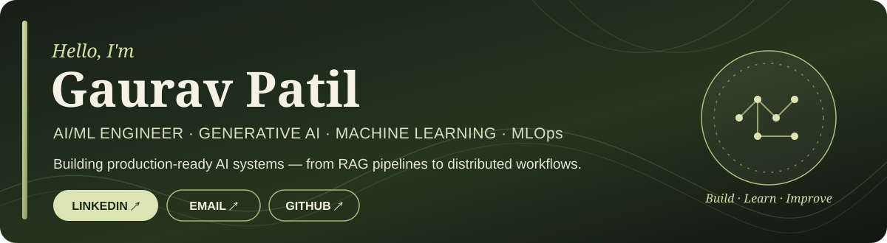
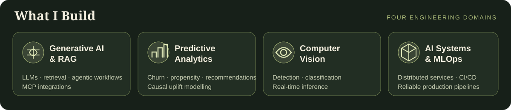
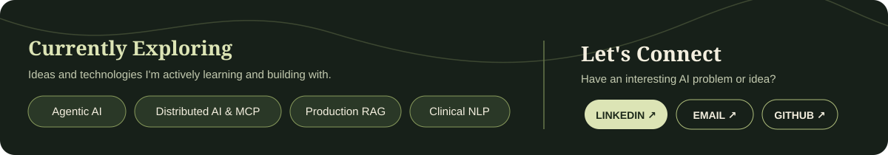

<!-- ═══════════════════════════════════════════════════════════
     BANNER  →  create banner.svg (or banner.png) in Canva
     ═══════════════════════════════════════════════════════════ -->

  

 

<!-- ═══════════════════════════════════════════════════════════
     ABOUT ME  +  WHAT I BUILD
     ═══════════════════════════════════════════════════════════ -->
<table width="100%">
<tr>
<td width="52%" valign="top">

### 👤 About Me

I build intelligent systems that bridge the gap between machine learning research and real-world applications.

With expertise in **Generative AI, Computer Vision** and **Distributed AI Systems**, I enjoy designing and deploying scalable solutions that solve complex business and engineering problems.

My work spans predictive modelling, customer intelligence, hybrid RAG architectures, clinical AI, multi-agent workflows and scalable ML infrastructure.

</td>
<td width="48%" valign="top">

</td>
</tr>
</table>

 

<!-- ═══════════════════════════════════════════════════════════
     TECH STACK  +  ENGINEERING IMPACT
     ═══════════════════════════════════════════════════════════ -->
<table width="100%">
<tr>
<td width="52%" valign="top">

### </> Tech Stack

**ML & AI**

**Cloud & MLOps**

</td>
<td width="48%" valign="top">

</td>
</tr>
</table>

 

<!-- ═══════════════════════════════════════════════════════════
     EXPERIENCE  +  EDUCATION
     ═══════════════════════════════════════════════════════════ -->
<table width="100%">
<tr>
<td width="52%" valign="top">

### 💼 Experience

🟢 **Comsense Technologies** &nbsp; `Dec 2025 – Present`
 GenAI Specialist · Building enterprise AI solutions

🟡 **Breathing.ai** &nbsp; `Feb 2024 – Dec 2024`
 ML Engineer · Computer vision & model optimisation

🔵 **University of Illinois Springfield** &nbsp; `Dec 2023`
 ML Research · Data Science & Analytics

</td>
<td width="48%" valign="top">

### 🎓 Education

🟢 **IIT Bombay**
 PG in AI & Data Science · Dec 2025

🟡 **University of Illinois Springfield**
 MS Computer Science · Dec 2023

🔵 **University of Mumbai**
 BE Computer Science · May 2022

</td>
</tr>
</table>

 

<!-- ═══════════════════════════════════════════════════════════
     GITHUB STATS
     ═══════════════════════════════════════════════════════════ -->
<table width="100%">
<tr>
<td width="50%" align="center">

</td>
<td width="50%" align="center">

</td>
</tr>
</table>

 

<!-- ═══════════════════════════════════════════════════════════
     FOOTER  →  create footer.svg
     ═══════════════════════════════════════════════════════════ -->

  

