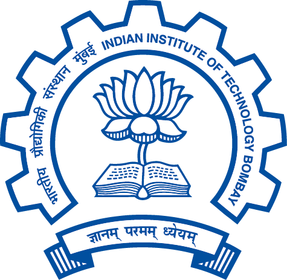

<h1 align="center">Hey, I'm Gaurav Patil 👋</h1>

  <b>AI/ML Engineer · Generative AI · MLOps · Mumbai, India</b> 
  Building production-ready AI systems — from RAG pipelines to multi-agent workflows

  
  
  

---

## 🚀 What I Build

- **Agentic AI & LLMs** — RAG pipelines, multi-agent workflows, MCP server integrations
- **Applied ML** — churn prediction, next-best-product, causal uplift modelling
- **Clinical AI** — patient summarisation, medication safety guardrails, deterministic validation
- **MLOps** — CI/CD for ML, SageMaker deployments, inference optimisation

---

## 🛠️ Tech Stack

**ML & AI**

**Cloud & MLOps**

**Data**

---

## 📊 Engineering Impact

---

## 💼 Experience

### 🟢 Machine Learning Engineer – GenAI Specialist
**Comsense Technologies** · Dec 2025 – Present

**ML Engineering – Client Solutions**
- Built production MLOps inference pipelines for Next Best Product (XGBoost) and Omnichannel Churn Prediction (CatBoost)
- Architected dual-layer identity resolution using PySpark and NetworkX graph healing to consolidate fragmented retail identities into an auditable Golden ID
- Engineered a Multi-Arm Causal Uplift engine using dual XGBoost models to estimate incremental customer spend across discount tiers

**Internal Product Engineering**
- Developed a FastMCP server to decouple document logic from clients, enabling model-agnostic orchestration across LLMs
- Engineered an Adversarial Multi-Agent Audit Framework, reducing manual verification effort by **80%**
- Designed self-healing extraction pipelines using Regex and JSON repair — **90% success rate** for valid schema injection

**RAG & Clinical AI**
- Developed a hybrid RAG pipeline (LangChain + FAISS), improving technical accuracy by **30%**
- Implemented contextual query rewriting with Gemini 3.0 Pro, increasing retrieval precision by **35%**
- Built a Technical State Manager to reduce token consumption by **40%**
- Implemented LLM guardrails for clinical summarisation with claim-level grounding and deterministic fallbacks

---

### 🟡 Generative AI Engineer
**Reality AI Labs** · Dec 2024 – Mar 2025 · New York, USA

- Increased user engagement and customer retention by **15%** by developing AI tools using LangChain, RAG and Multimodal AI

---

### 🟡 Machine Learning Engineer
**Breathing.ai** · Feb 2024 – Dec 2024 · New York, USA

- Optimised model training via CUDA GPU acceleration — 20% more efficient batch-size adjustments
- Enhanced model performance with XGBoost, reducing false positives by **30%** and increasing NPS by 10%
- Decreased deployment time by **40%** through CI/CD implementation using AWS Lambda and SageMaker
- Improved accuracy by **45%** using a posture correction platform built with OpenCV, SWIN Transformer and EfficientNetB0

---

### 🔵 Associate Data Analyst
**University of Illinois** · Apr 2023 – Dec 2023 · Springfield, IL

- Improved data-driven decision-making by **15%** through automated dashboards (Power BI, Matplotlib, Seaborn)
- Reduced reporting time by **40%** working with datasets of 100,000+ entries

---

### 🔵 AI Intern
**University of Illinois** · Aug 2023 – Sep 2023 · Springfield, IL

- Developed a chatbot using OpenAI GPT-3 and Pinecone for vector storage and retrieval
- Implemented Python-based web crawling to process HR documents, reducing manual query resolution time by **60%**

---

### 🔵 Machine Learning Research Assistant
**University of Illinois** · Sep 2022 – Apr 2023 · Springfield, IL

- Developed computer vision models using YOLOv5 and Mask R-CNN, improving recognition accuracy by **35%**
- Optimised real-time inference using ONNX and TensorRT, accelerating inference speed by **40%**

---

## 🎓 Education

<table>
  <tr>
    <td width="80"></td>
    <td><b>IIT Bombay</b> PG in AI & Data Science · Dec 2025</td>
  </tr>
  <tr>
    <td width="80"></td>
    <td><b>University of Illinois Springfield</b> MS Computer Science · Dec 2023</td>
  </tr>
  <tr>
    <td width="80"></td>
    <td><b>University of Mumbai</b> BE Computer Science · May 2022</td>
  </tr>
</table>

---

## 🌱 Currently Building

Agentic AI systems · Production RAG · Scalable LLM inference · Clinical NLP

---

*Open to AI/ML Engineer roles in Mumbai · DM or email to connect*
